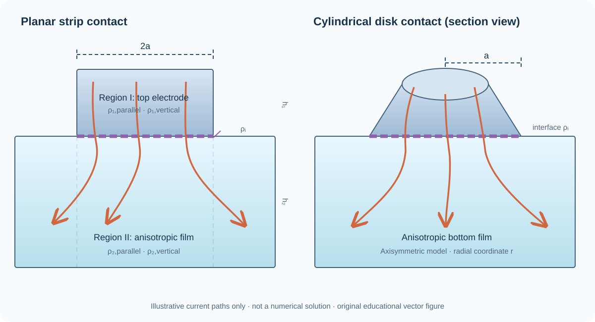
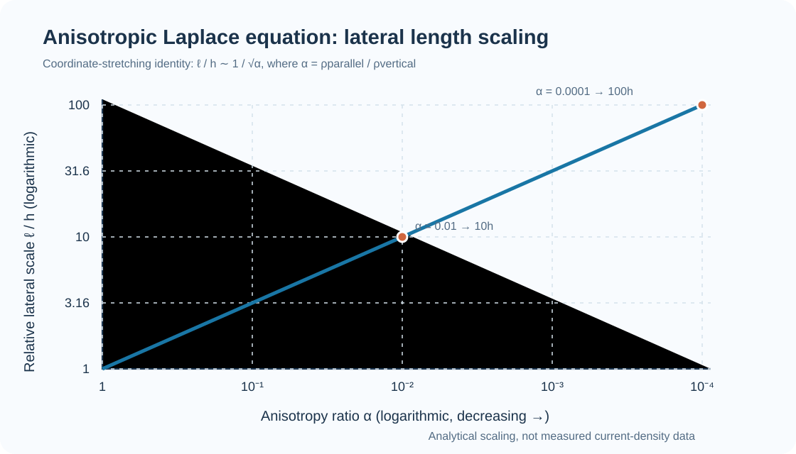

## Abstract

The electrical current beneath a small contact is not necessarily vertical, even when a voltage is applied across a thin-film stack. Graphite and transition-metal dichalcogenides frequently conduct much more easily parallel to their atomic layers than perpendicular to them. This anisotropy changes the entire potential field, concentrates current near contact edges, and can make an isotropic estimate of spreading resistance misleading. In this tutorial we develop the governing equation, transform the anisotropic field problem into an equivalent isotropic coordinate system, introduce the exact two-layer boundary conditions, and explain the Cartesian and cylindrical field expansions. We then connect the theory to finite-element validation, experimental HOPG and MoS$_2$ comparisons, and practical contact design. **The underlying original research is the peer-reviewed paper by Faisal and Zhang [1].**

> **Cite the original research:** M. A. Faisal and P. Zhang, “Impact of Anisotropic Conductivity on Current Crowding and Spreading Resistance in Vertical Contacts to 2D Thin Films,” *ACS Applied Electronic Materials*, **8**(2), 854–864 (2026). <a href="https://doi.org/10.1021/acsaelm.5c02130" target="_blank" rel="noopener">https://doi.org/10.1021/acsaelm.5c02130</a>. This webpage is an author-written educational explanation of that paper, not a replacement publication or a new DOI.

## 1. Why a vertical contact produces lateral current

Imagine an electrode placed on top of a layered conductor. For an isotropic medium, the local current density is aligned with the local electric field, and a simple picture of predominantly vertical transport can be adequate away from edges. A layered semiconductor is different. Motion parallel to the atomic sheets can be much easier than transport across the van der Waals gaps.

The difference is especially relevant for graphite and transition-metal dichalcogenides such as MoS$_2$ and WSe$_2$. A finite electrode must inject charge into an extended sheet, but the charge can spread laterally before it travels vertically. Its current-density field therefore depends on both components of resistivity, on the contact footprint, and on the thickness and width of the film [1,3].

**Current crowding** refers to the localization of current density, often near a contact perimeter. **Spreading resistance** refers to the additional voltage drop associated with nonuniform current paths. These are related but not interchangeable quantities: reducing the net resistance does not necessarily eliminate an intense local current-density peak [1].

<figure class="article-figure">
  
  <figcaption><strong>Figure 1.</strong> Contact geometry underlying the analytical model. Region I is a finite top electrode and Region II is a laterally wider film; a finite specific interfacial resistivity couples the two. Solid curves are qualitative current paths, not numerical field solutions. Original schematic created for this tutorial after the geometry of Ref. [1].</figcaption>
</figure>

## 2. Begin with current conservation and tensor Ohm's law

For steady conduction without charge accumulation,

$$
\nabla\cdot\mathbf J=0.
$$

For a linear, locally homogeneous conductor with principal conductivity axes aligned to the material layers,

$$
\mathbf J=-\boldsymbol{\sigma}\nabla\Phi,
\qquad
\boldsymbol{\sigma}=
\begin{pmatrix}
\sigma_t&0\\
0&\sigma_z
\end{pmatrix}.
$$

Here $t$ is the in-plane coordinate and $z$ is the out-of-plane coordinate. Substitution gives the **anisotropic Laplace equation**

$$
\nabla\cdot\left(\boldsymbol{\sigma}\nabla\Phi\right)=0.
$$

For a Cartesian film, $t=y$. If the material properties are uniform in each region, the governing equation becomes

$$
\sigma_y\frac{\partial^2\Phi}{\partial y^2}
+
\sigma_z\frac{\partial^2\Phi}{\partial z^2}=0.
$$

The two directional resistivities and the anisotropy ratio are

$$
\rho_y=\frac{1}{\sigma_y},\qquad
\rho_z=\frac{1}{\sigma_z},\qquad
\alpha=\frac{\rho_y}{\rho_z}
=\frac{\sigma_z}{\sigma_y}.
$$

Consequently,

$$
\boxed{
\frac{\partial^2\Phi}{\partial y^2}
+\alpha\frac{\partial^2\Phi}{\partial z^2}=0
}.
$$

For an isotropic medium, $\alpha=1$. A layered conductor with $\rho_y\ll\rho_z$ has $\alpha\ll1$. This is the same anisotropy convention used in Ref. [1]. There are two different ratios $\alpha_1$ and $\alpha_2$ when **both** contact members are anisotropic.

## 3. Understand anisotropy by stretching the coordinates

The equation above has a useful mathematical interpretation. Define a transformed vertical coordinate,

$$
z'=\frac{z}{\sqrt{\alpha}}.
$$

The chain rule gives

$$
\frac{\partial^2\Phi}{\partial z^2}
=\frac{1}{\alpha}
\frac{\partial^2\Phi}{\partial z'^2},
$$

so that

$$
\frac{\partial^2\Phi}{\partial y^2}
+\frac{\partial^2\Phi}{\partial z'^2}=0.
$$

In the transformed coordinates, the bulk differential equation is isotropic. The physical contact is not isotropic, however: a vertical distance $h$ becomes $h/\sqrt{\alpha}$ in the transformed system. Equivalently, a typical lateral distance associated with a vertical scale $h$ scales as

$$
\boxed{\ell_t\sim\frac{h}{\sqrt{\alpha}}}.
$$

This is a **coordinate-stretching scale**, not a universal fitted transfer length or an exact current-crowding formula. The full contact profile still depends on electrode geometry, other layers, the interface, and boundary conditions. It explains why the lateral spatial extent of the potential can be far larger than the physical layer thickness when $\alpha$ is small.

<figure class="article-figure">
  
  <figcaption><strong>Figure 2.</strong> Exact coordinate-stretching factor $1/\sqrt{\alpha}$ for a homogeneous anisotropic conductivity tensor, together with illustrative potential-contour geometry. This is an analytical scaling identity, **not** a reproduction of the contact-resistance measurements or numerical results in Ref. [1].</figcaption>
</figure>

A numerical example makes the implication clear. If $\alpha=10^{-2}$, then $1/\sqrt{\alpha}=10$. If $\alpha=10^{-4}$, it becomes $100$. Thus strongly anisotropic material can redistribute electrical potential over a lateral distance much greater than a single film thickness. The finite contact boundaries ultimately limit the spatial response.

## 4. Set up the actual two-layer vertical-contact problem

The original research treats two conducting regions, **both allowed to be anisotropic**, rather than a perfectly conducting electrode deposited on a single anisotropic half-space [1].

For the planar strip configuration, let the upper electrode (Region I) occupy

$$
-a\le y\le a,\qquad 0\le z\le h_1,
$$

and the lower semiconductor (Region II) occupy

$$
-b\le y\le b,\qquad -h_2\le z\le0,
\qquad b>a.
$$

The physical parameters are $\rho_{1,y}$, $\rho_{1,z}$, $\rho_{2,y}$, $\rho_{2,z}$, film thicknesses $h_1,h_2$, the two half-widths $a,b$, and the specific interface resistivity $\rho_i$ (units $\Omega\,\mathrm{m}^2$).

A convenient statement of the boundary conditions in the paper is:

1. The top contact face is held at $\Phi_{\mathrm I}(y,h_1)=0$.
2. The lower face is held at $\Phi_{\mathrm {II}}(y,-h_2)=V_0$.
3. The outer lateral walls are electrically insulating, so $\mathbf J\cdot\mathbf n=0$.
4. The exposed upper face of Region II outside the footprint is insulating: $J_{\mathrm {II},z}(y,0)=0$ for $a<|y|\le b$.
5. Through the interface, normal current is continuous, while the voltage drop is proportional to local normal current density.

With the orientation convention of Ref. [1], the interface relation is

$$
J_{\mathrm I,z}(y,0^+)
=J_{\mathrm {II},z}(y,0^-),
$$

$$
\boxed{
\Phi_{\mathrm {II}}(y,0^-)
-\Phi_{\mathrm I}(y,0^+)
=\rho_i J_z(y,0)
},\qquad |y|\le a.
$$

The last equation is crucial. A finite interface resistivity permits a **potential jump** across an infinitesimally thin interface, while conserving current. Taking $\rho_i\to0$ recovers potential continuity, not zero current.

## 5. Separate variables to obtain the planar field solution

In Region I, solve

$$
\frac{\partial^2\Phi_{\mathrm I}}{\partial y^2}
+\alpha_1
\frac{\partial^2\Phi_{\mathrm I}}{\partial z^2}=0,
\qquad
\alpha_1=\frac{\rho_{1,y}}{\rho_{1,z}}.
$$

Take $\Phi(y,z)=Y(y)Z(z)$. Division by $YZ$ produces two ordinary differential equations,

$$
Y''+k^2Y=0,\qquad
Z''-\frac{k^2}{\alpha_1}Z=0.
$$

The insulating lateral boundaries select cosine modes (for the symmetric problem),

$$
Y_n(y)=\cos\left(\frac{n\pi y}{a}\right),
\qquad
k_{1,n}=\frac{n\pi}{a},
$$

and the vertical decay factor is

$$
\gamma_{1,n}=\frac{k_{1,n}}{\sqrt{\alpha_1}}.
$$

The corresponding Region II modes use the larger half-width and its own anisotropy,

$$
k_{2,n}=\frac{n\pi}{b},\qquad
\gamma_{2,n}=\frac{k_{2,n}}{\sqrt{\alpha_2}}.
$$

One illustrative representation satisfying the fixed-potential upper and lower faces is

$$
\Phi_{\mathrm I}(y,z)
=A_0(h_1-z)+
\sum_{n=1}^{\infty}
A_n\sinh\!\left[\gamma_{1,n}(h_1-z)\right]
\cos\left(\frac{n\pi y}{a}\right),
$$

$$
\Phi_{\mathrm {II}}(y,z)
=V_0+B_0(z+h_2)+
\sum_{n=1}^{\infty}
B_n\sinh\!\left[\gamma_{2,n}(z+h_2)\right]
\cos\left(\frac{n\pi y}{b}\right).
$$

The coefficients are **not independently chosen**. Projecting the interface and exposed-surface conditions onto these lateral modes produces a coupled linear system. Solving that system is what makes the two-layer result self-consistent. The exact coefficient relations and final planar resistance are provided in Eqs. (2a)–(2c) and Supporting Information Section S1 of Ref. [1].

Notice the physical factor $k_n/\sqrt{\alpha}$. The same lateral Fourier variation penetrates a different vertical distance when the conductivity tensor changes. Replacing $\rho_y$ and $\rho_z$ by one average resistivity before solving loses this mode-dependent structure.

## 6. Extend the derivation to cylindrical disk contacts

The paper also treats a circular electrode of radius $a$ deposited on a circular lower region of radius $b$. For axisymmetric conduction, the tensor equation becomes

$$
\frac{1}{r}\frac{\partial}{\partial r}
\left(r\sigma_r\frac{\partial\Phi}{\partial r}\right)
+\sigma_z\frac{\partial^2\Phi}{\partial z^2}=0.
$$

For constant material properties,

$$
\frac{1}{r}\frac{\partial}{\partial r}
\left(r\frac{\partial\Phi}{\partial r}\right)
+\alpha\frac{\partial^2\Phi}{\partial z^2}=0.
$$

Separation of variables leads to radial Bessel modes $J_0(\lambda r)$. On a sidewall with zero radial current,

$$
\left.\frac{\partial\Phi}{\partial r}\right|_{r=a\ \mathrm{or}\ b}=0
\quad\Longrightarrow\quad
J_1(\lambda a)=0
\quad\mathrm{or}\quad
J_1(\lambda b)=0.
$$

Thus planar contacts use cosine modes, while disk contacts use Bessel modes. **The two geometries share the same tensor physics but have different mode spectra and contact-area factors.** The exact axisymmetric potential and spreading-resistance formulas appear in Eqs. (3a)–(3c) and Supporting Information Section S4 of Ref. [1].

## 7. Extract current density and separate resistance contributions

Once the potential is known, neither the current-density map nor the terminal current needs to be guessed:

$$
J_t=-\sigma_t\frac{\partial\Phi}{\partial t},
\qquad
J_z=-\sigma_z\frac{\partial\Phi}{\partial z},
$$

$$
|\mathbf J|=\sqrt{J_t^2+J_z^2}.
$$

For a planar contact with out-of-plane width $W$,

$$
I=W\int_{-a}^{a}J_z(y,0)\,dy.
$$

For a circular contact,

$$
I=2\pi\int_0^a J_z(r,0)\,r\,dr.
$$

The total resistance of the biased stack is $R_T=V_0/I$ (using the sign convention for positive current magnitude). The original paper defines the contact resistance by subtracting the lower-layer background contribution, $R_c=R_T-R_b$, and derives the **spreading/constriction component** from the exact modal coefficients. The nominal interface-area terms are

$$
R_{i,\mathrm{planar}}=\frac{\rho_i}{2aW},
\qquad
R_{i,\mathrm{disk}}=\frac{\rho_i}{\pi a^2}.
$$

Those expressions are area-normalized interface contributions for a spatially uniform $\rho_i$. The coupled field solution is still required to determine nonuniform local injection and the total resistance of a finite bilayer.

The distinction matters in practice: a low measured $R_T$ can coexist with a high maximum of $|\mathbf J|$, and a reduction in $\rho_y$ can increase edge localization even while making lateral spreading energetically easier [1].

## 8. Understand what the published potential and current maps show

The research compares five representative material combinations: isotropic Au–a-Si, Au–WSe$_2$, graphite–MoS$_2$, Au–graphite, and graphite–graphite. For example, the reported lower-layer anisotropy parameters include $\alpha_2=0.1333$ for the Au–WSe$_2$ example, $\alpha_2=9\times10^{-3}$ for graphite–MoS$_2$, and $\alpha_2=2.73\times10^{-5}$ for the graphite example [1, Figs. 3–4].

The potential maps show that highly conductive in-plane directions reshape the spatial voltage profile along the interface. The corresponding current-density maps show stronger localization close to electrode edges and an extended band of current in the anisotropic lower region. The two effects should be interpreted together: **electrostatic potential spreading is not the same quantity as the local magnitude of current density**.

These are results of the **published exact two-layer solution**, independently checked against finite-element calculations in the paper. Figures 1–2 on this webpage are new educational schematics and analytical illustrations; they do not reproduce those simulation maps or purport to be newly calculated FEM benchmarks.

## 9. When does the familiar diffusive resistance formula work?

For a disk-like contact in the wide, sufficiently thick diffusive limit, the classical expression is

$$
\boxed{
R_s\simeq\frac{\rho_{\mathrm{eff}}}{4a},
\qquad
\rho_{\mathrm{eff}}=\sqrt{\rho_{2,r}\rho_{2,z}}
}.
$$

This is the limiting expression used in the paper for its HOPG and MoS$_2$ comparisons [1,4,5]. It is useful because it predicts the familiar inverse-radius trend, $R_s\propto1/a$.

It is **not** a general result for arbitrary film thickness or contact geometry. The exact theory retains $b/a$, $h_1/a$, $h_2/a$, $\alpha_1$, $\alpha_2$, $\rho_{1,z}/\rho_{2,z}$, and $\rho_i$. When $b$ is comparable to $a$, or the lower film is very thin, a semi-infinite diffusive formula discards important boundary information. A scalar effective resistivity may reproduce a limiting total resistance without recovering the actual nonuniform current field [1].

### Published experimental checks

The paper compares the cylindrical solution with spreading-resistance data for **highly oriented pyrolytic graphite** measured by Koren and coauthors [4] and **multilayer MoS$_2$** measured by Vijayan and coauthors [5]. The article reports agreement using independently specified material properties, without introducing fit parameters for its benchmark curves [1].

The reported analyses also explore narrower finite-width channels and nanometer-scale films. These reveal departures from the simple $1/a$ scaling in geometries where finite boundaries and anisotropy cannot be neglected. The proper conclusion is conditional: the classical formula can be accurate in its asymptotic regime, but should not be extrapolated indiscriminately to ultra-thin, laterally confined device stacks.

## 10. How to use the theory in your own device design

A reliable workflow for modeling an electrical contact is:

1. **Measure the geometry.** Record the contact half-width or radius $a$, available lateral extent $b$, and the thicknesses $h_1$ and $h_2$.
2. **Keep directional resistivities separate.** Use $\rho_{1,t},\rho_{1,z},\rho_{2,t},\rho_{2,z}$; compute $\alpha_1$ and $\alpha_2$.
3. **Specify the interface.** Determine whether a constant specific resistivity $\rho_i$ is a reasonable small-signal DC approximation.
4. **Choose the geometry.** Use cosine eigenmodes for a planar strip or Bessel eigenmodes for a circular contact.
5. **Solve the coupled boundary-value problem.** Use the exact expressions from Ref. [1], or a sufficiently resolved FEM model when the geometry or interface varies spatially.
6. **Check both outputs.** Extract $R_s$ and $R_c$, but also inspect $J_z$ and $|\mathbf J|$ around the contact perimeter.
7. **Check limiting cases.** The solution should recover the isotropic theory at $\alpha_1=\alpha_2=1$, the perfect-interface limit as $\rho_i\to0$, and the appropriate wide/thick diffusive limit for disks.

For fixed geometry, the paper finds that reducing the **out-of-plane resistivity of the lower film**, $\rho_{2,z}$, is often a more effective resistance-reduction strategy than pushing an already small in-plane resistivity still lower. Reducing the interfacial resistivity can also help. But geometry and edge crowding must be assessed separately when reliability or Joule heating is the design concern [1].

## 11. Limits of the theory

The exact analytical model in Ref. [1] is a **steady-state, linear DC conduction model** with prescribed material resistivities and a laterally uniform interface parameter. It does not itself predict microscopic tunneling, Schottky barrier formation, temperature-dependent electromigration, or time-dependent thermal runaway. Those physical effects require additional constitutive laws and, where appropriate, coupled electrical–thermal or quantum transport calculations. Its value is the clean, general baseline for the current distribution and resistance of finite anisotropic contacts.

## Source publication and how to cite

This tutorial is an author-written explanation **based primarily on Ref. [1]**. The original exact two-layer solutions, supporting derivations, experimental benchmarks, and claims of novelty belong to that peer-reviewed article. **For a scientific statement or derivation originating in the paper, cite the journal paper rather than this webpage.**

**Recommended citation (original research):** M. A. Faisal and P. Zhang, “Impact of Anisotropic Conductivity on Current Crowding and Spreading Resistance in Vertical Contacts to 2D Thin Films,” *ACS Applied Electronic Materials*, vol. 8, no. 2, pp. 854–864, 2026. DOI: <a href="https://doi.org/10.1021/acsaelm.5c02130" target="_blank" rel="noopener">10.1021/acsaelm.5c02130</a>.

The <a href="https://pbi.engin.umich.edu/wp-content/uploads/sites/678/2026/02/2026-ACS-AEM-anisotropic-conductivity-contacts.pdf" target="_blank" rel="noopener">university-hosted publication and supporting-information PDF</a> gives the original numbered equations and experimental figures.

## References

1. **M. A. Faisal and P. Zhang**, “Impact of Anisotropic Conductivity on Current Crowding and Spreading Resistance in Vertical Contacts to 2D Thin Films,” *ACS Applied Electronic Materials*, **8**(2), 854–864 (2026). <a href="https://pubs.acs.org/aaembp/article/8/2/854/5081981/Impact-of-Anisotropic-Conductivity-on-Current" target="_blank" rel="noopener">Publisher article</a>; <a href="https://doi.org/10.1021/acsaelm.5c02130" target="_blank" rel="noopener">DOI: 10.1021/acsaelm.5c02130</a>.
2. P. Zhang and Y. Y. Lau, “Constriction Resistance and Current Crowding in Vertical Thin Film Contact,” *IEEE Journal of the Electron Devices Society*, **1**, 83–90 (2013). This earlier work established an isotropic finite-contact field framework extended by [1].
3. K. Seki, T. Kubo, N. Ye, and T. Shimizu, “Quantifying the Spreading Resistance of an Anisotropic Thin Film Conductor,” *Scientific Reports*, **10**, 10633 (2020).
4. E. Koren, A. W. Knoll, E. Lörtscher, and U. Duerig, “Meso-scale Measurement of the Electrical Spreading Resistance in Highly Anisotropic Media,” *Applied Physics Letters*, **105**, 123112 (2014).
5. G. Vijayan, M. Uzhansky, and E. Koren, “Spreading Resistance and Conductance Anisotropy in Multilayer MoS$_2$,” *Applied Physics Letters*, **124**, 133101 (2024).
6. **Related IEEE Xplore publication**, document 11779869. <a href="https://ieeexplore.ieee.org/abstract/document/11779869" target="_blank" rel="noopener">Publisher record</a>. The publisher record should be consulted for its authoritative title, authors, and DOI; these details are not inferred here.

---

**License.** Unless otherwise noted, original text and vector illustrations on this page are licensed under <a href="https://creativecommons.org/licenses/by/4.0/" target="_blank" rel="noopener">Creative Commons Attribution 4.0 (CC BY 4.0)</a>. The journal publication and third-party material remain subject to their respective publishing terms.
